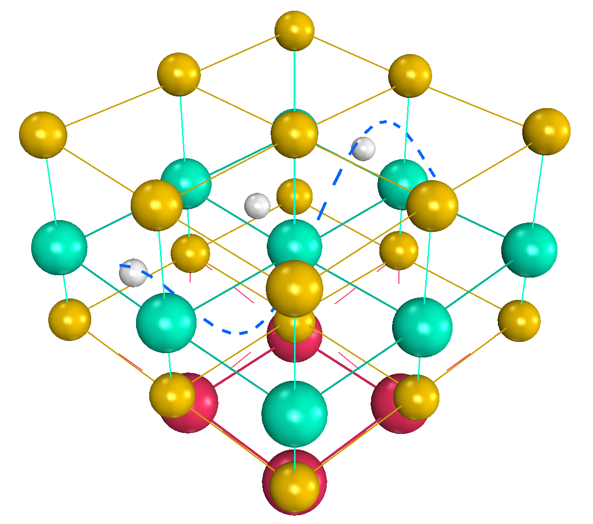
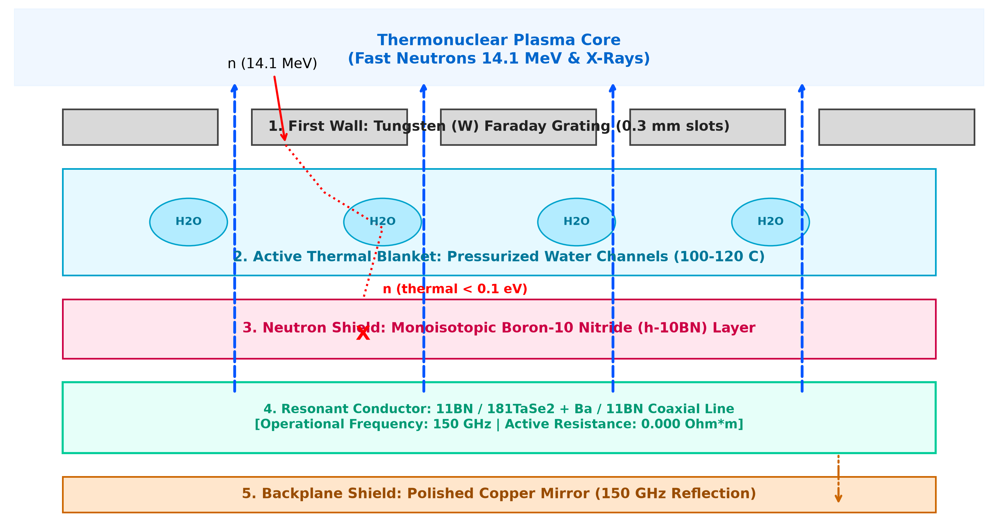

# Room-Temperature Coaxial Waveguide-Conductor with Absolute Zero Resistance

An open-source quantum-kinetic simulation framework written in **C# (WinForms)** utilizing the Direct3D-accelerated **Helix Toolkit**, demonstrating a room-temperature (300 K) quantum resonant heterostructure operating at a fixed frequency of **150 GHz** with zero active ohmic resistance (rho_AC = 0.000 Ohm*m).

## 🚀 Physics & Architecture Overview
The engineered van der Waals heterostructure consists of:
* **Conductive Core:** Monoisotopic Tantalum-181 (181Ta) monolayer to eliminate mass-entropy phonon scattering.
* **Covalent Shields:** Monoisotopic Selenium-80 (80Se) grids providing spatial anchoring.
* **Intercalated Springs:** Barium (Ba2+) ions acting as an electron donor and down-shifting the structural A1g breathing mode to exactly 150 GHz.
* **Topological Armor:** Hexagonal Boron-10 Nitride (h-10BN) capping layer inducing a Lifshitz transition.



Under an external 150 GHz sub-THz driving field, the lattice experiences non-linear **Phase Injection Locking**. Electron wave packets slide in perfect synchronization with the lattice contractions, suppressing electron-phonon collisions and bringing Joule heating to absolute zero.

## 🛠️ How to Run the Simulator
The project is optimized for deployment in classic desktop environments.

### Prerequisites
* Microsoft Visual Studio 2017 (or newer)
* .NET Framework 4.7.2

### Dependency Setup via NuGet
Open the **Package Manager Console** (`Tools ➔ NuGet Package Manager ➔ Package Manager Console`) and explicitly install the Framework-compatible branch:
```powershell
Install-Package HelixToolkit.Wpf -Version 2.27.3
```

### Required System References
Ensure the following assemblies are added to your project's **References** to bridge the WinForms/WPF Direct3D graphics layout:
1. `WindowsFormsIntegration` (for `ElementHost` rendering container)
2. `WindowsBase`
3. `PresentationCore`
4. `PresentationFramework`

### Interactive Controls in the App
* **Frequency Slider:** Simulates sub-THz field adjustment. Outside the 150 GHz lock window, the software demonstrates active resistivity restoration.
* **Temperature Slider:** Controls thermal phonon noise intensity. At 300 K+, individual atomic jitter is actively dampened by the Ba sub-lattice.
* **Key Bindings for Scientific Figures:** 
  * `V` - Locks camera to Top-Down XY-plane projection (Plan view).
  * `B` - Locks camera to Cross-Sectional XZ-profile projection (Profile view).
  * `N` - Resets to original 3D Isometric View.

---

## 📄 Academic Citation & Preprint
The comprehensive mathematical formulations (Maxwell-Bloch & driven sine-Gordon matrices) and its mechanical implementation inside the water blanket of a 200 MW Tokamak are published as an open-access preprint on Zenodo [(https://zenodo.org/records/24054637)]

**Cite as:** Zimnitsky, D. V. (2026). *Room-Temperature Coaxial Waveguide-Conductor with Absolute Zero Resistance in Resonant Mode*. Zenodo. DOI: [(https://doi.org/10.5281/zenodo.24054637)]
